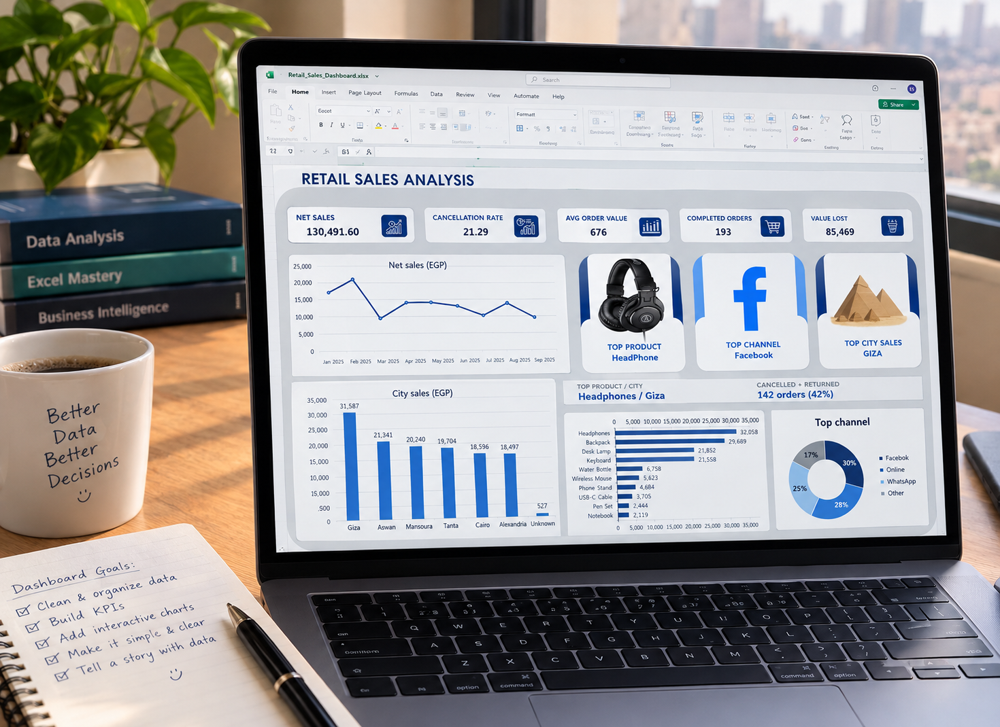

<div align="center">

# Retail Sales Analysis Dashboard

**Turning retail data into clear, actionable business insights with Microsoft Excel.**



</div>

---

## Overview

This project presents a retail sales dashboard concept designed to help users review sales performance, monitor key performance indicators (KPIs), and compare results across time, products, cities, and sales channels.

The goal is to turn raw sales data into a concise visual overview that supports faster, data-informed business decisions.

## Dashboard Highlights

| KPI / Analysis | Purpose |
|---|---|
| Net Sales | Review overall sales performance |
| Cancellation Rate | Monitor cancelled orders |
| Average Order Value | Understand average order value |
| Completed Orders | Track fulfilled orders |
| Value Lost | Highlight value associated with lost or cancelled orders |
| Monthly Sales Trend | Compare sales performance over time |
| Sales by City | Identify stronger and weaker locations |
| Top Products | Compare product-level sales |
| Sales Channel Mix | Review the contribution of each channel |

## Preview

### Sales channel analysis

A channel breakdown helps compare the relative contribution of different sales channels.

> **Note:** The same presentation image is used for each preview section. These are not separate chart exports.

## Tools & Skills

- Microsoft Excel
- Data cleaning and preparation
- PivotTables and chart-based analysis *(include only if implemented in the workbook)*
- Data visualization
- Business performance analysis

## Business Questions

This dashboard concept is designed to help explore questions such as:

1. How do sales change from month to month?
2. Which cities contribute the most to sales?
3. Which products have the highest sales value?
4. How are orders distributed across sales channels?
5. What proportion of orders are cancelled or returned?

## Repository Contents

```text
Retail-Sales-Analysis/
├── README.md
├── Retail_Sales_Dashboard.xlsx
├── Datafile/
    └──  Retail-Sales_pivotTable.xlsx  
└── assets/
    └── retail-sales-dashboard-ugc.png
```

Do not upload customer-sensitive or confidential data.

## How to Use

1. Clone or download this repository.
2. Open the Excel workbook once it has been added.
3. Review the dashboard and filters, if included.
4. Compare charts to explore sales performance.

## Data & Accuracy Note

The image above is a generated presentation mockup. It is intended for portfolio presentation and is **not evidence of a functioning Excel dashboard**. Confirm all figures against the source dataset and replace this mockup with a genuine screenshot of the completed workbook before presenting the project as fully implemented.

## Future Improvements

- Add the source workbook and document the data-cleaning steps.
- Include interactive filters or slicers, if supported by the workbook.
- Add a short findings section with verified insights from the data.
- Include screenshots of the actual dashboard and supporting worksheets.

---

<div align="center">

**Excel · Data Analytics · Dashboard Design · Business Intelligence**

</div>
